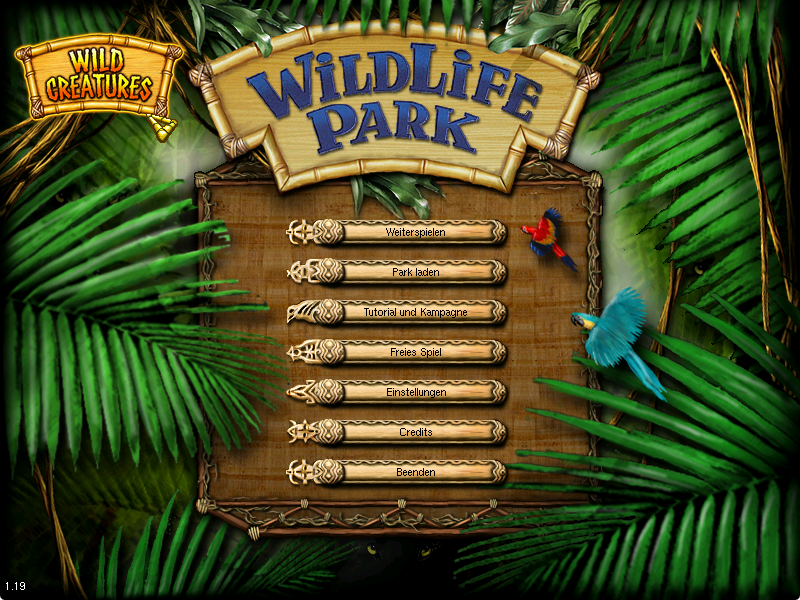
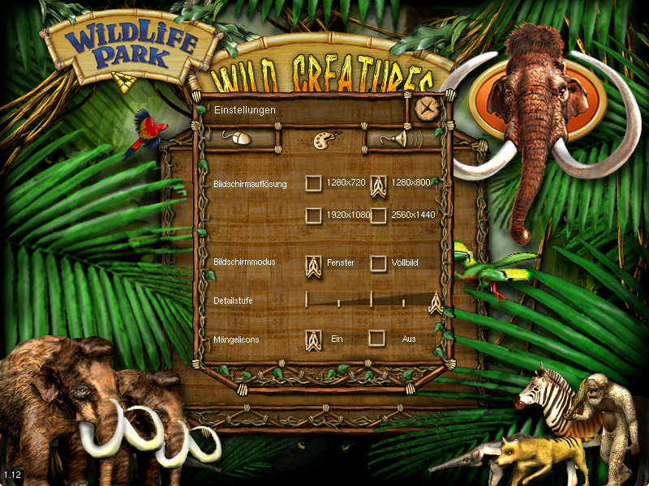
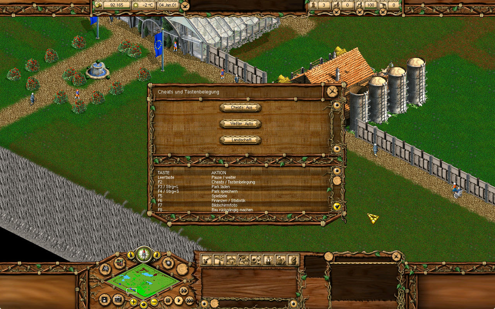
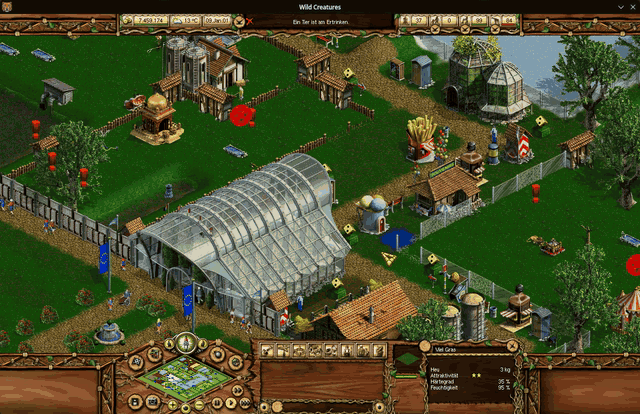

# Wildlife Park Modern Patch

Widescreen support, improved menus, and fixes for modern computers.
For **Wildlife Park Gold** and **Wild Creatures**.

## [Download the mod](https://github.com/blazze11/wildlife-park-modern-patch/releases/latest)

1. Close the game and back up its **Int** folder.
2. Download the **drag-and-drop.zip** file and unzip it.
3. Copy the included **Int** folder into your game folder (where **Config.ini** is). Choose **Replace**, then start the game.

Your saves and settings stay as they are. The full game must already be installed. Tested with the German edition; other editions are unverified.

To remove the mod, restore your backup.

## Modified files

The download replaces these six files:

- `Int/Win32/Program/VC6/WLP.EXE`
- `Int/Win32/Program/VC6/WLPADD1.EXE`
- `Int/All/Pictures/GUI.alb`
- `Int/All/Pictures/Addon1/GUI_AddOn1.alb`
- `Int/All/Pictures.cont`
- `Int/All/Pictures_Addon1.cont`

## Screenshots

**Switch between Wildlife Park and Wild Creatures from the main menu.**

**16:9 and 16:10 resolutions, including 1280 × 800 for Steam Deck.**

**Custom F2 menu for cheats and a keyboard shortcut overview.**

**Short preview of the changes.**

Patch version: **0.38.2**. Developers can find the patch tools and research in the source ZIP. The community patch source uses GPL-3.0; original game files and assets belong to their respective owners.
